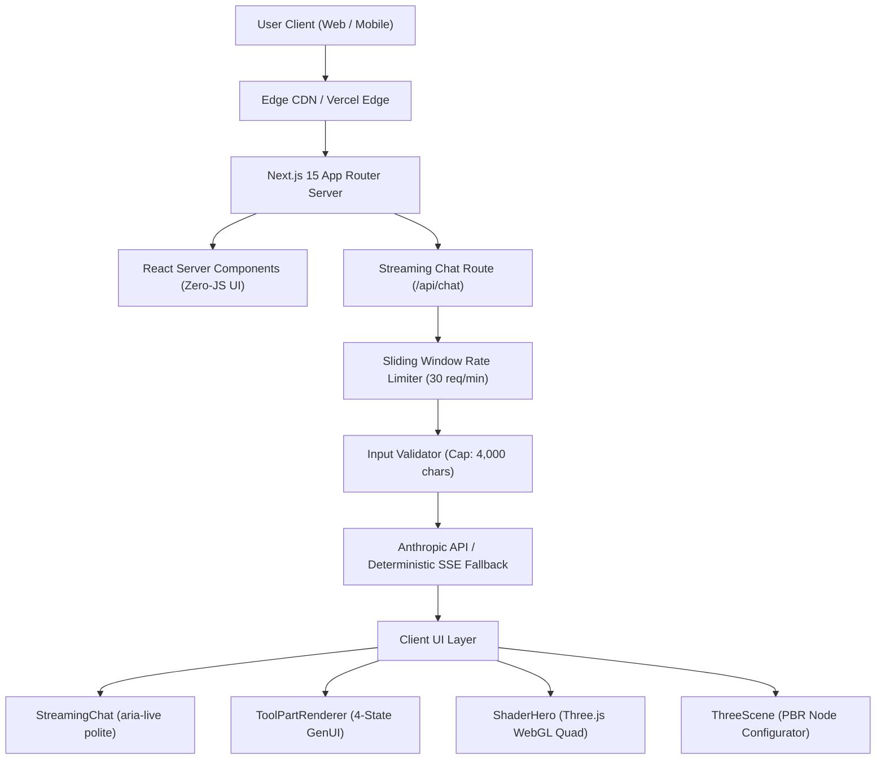

# FlyRank Frontend AI Engineering Capstone Platform


Production-grade Next.js 15 enterprise platform built during the **FlyRank Frontend AI Engineering Internship**. The application bridges modern generative UI systems, real-time Server-Sent Events (SSE) token streaming, Three.js WebGL spatial computing, custom GLSL fragment shaders, physics-based micro-interactions, and rigorous WCAG 2.1 AA accessibility.

---

## 🌐 Production URLs & Deployment

- **Production Live URL:** [https://flyrank-internship-front-end-ai-engineering.vercel.app](https://flyrank-internship-front-end-ai-engineering.vercel.app)
- **Primary GitHub Repository:** [https://github.com/KMSiam/Flyrank-Internship-Front-end-AI-Engineering](https://github.com/KMSiam/Flyrank-Internship-Front-end-AI-Engineering)
- **Internship Overview Tracker:** [https://github.com/KMSiam/Flyrank-Internship-AI](https://github.com/KMSiam/Flyrank-Internship-AI)
- **Synthetic Health Diagnostic:** [https://flyrank-internship-front-end-ai-engineering.vercel.app/health](https://flyrank-internship-front-end-ai-engineering.vercel.app/health)
- **Health API Probe:** [https://flyrank-internship-front-end-ai-engineering.vercel.app/api/health](https://flyrank-internship-front-end-ai-engineering.vercel.app/api/health)

---

## 📸 Platform Screens & Feature Map

| Route | Feature Area | Description & Architecture |
| :--- | :--- | :--- |
| **`/`** | **Signature Hero: Fullscreen Shader** | Three.js WebGL fragment shader hero with interactive pointer ripple, 4-octave fBm fluid aurora ribbons, DPR capping (&le; 2.0), and `prefers-reduced-motion` static gradient fallback. |
| **`/chat`** | **Streaming AI Chat Studio** | Token-by-token SSE streaming interface with live thinking indicators, abort controller stop action, layout-accurate skeletons, and `aria-live="polite"` screen-reader live regions. |
| **`/generative-ui`** | **Tool Results & GenUI** | Schema-driven dynamic UI rendering 4-state tool lifecycles (streaming input, input available, output ready, error card) using structured Zod schemas. |
| **`/three-d`** | **3D Quantum Neural Node** | Interactive 3D scene built on Three.js r170 featuring procedural geometry switching, PBR physical lighting, touch orbit controls, and 0 KB model footprint. |
| **`/micro-interactions`**| **Buttons with a Brain** | Six-state micro-interaction buttons (`idle` &rarr; `hover` &rarr; `active` &rarr; `loading` &rarr; `success` / `error`) with compositor-clean transitions (`transform`, `opacity`) and zero layout thrash. |
| **`/finops`** | **LLM Token FinOps Tracker** | Real-time cost attribution, prompt token meters, cache hit ratios, and latency percentiles across Claude, Gemini, and GPT-4o. |
| **`/workflows`** | **Visual Workflow Studio** | Node-based visual prompt chaining canvas for designing multi-agent autonomous execution graphs. |
| **`/multimodal`** | **Vision & Document Canvas** | Split-pane multimodal workspace with OCR coordinate mapping and visual reasoning overlays. |
| **`/settings`** | **AI Governance & Router** | Provider key validation, temperature sliders, fallback routing rules, and content safety thresholds. |
| **`/health`** | **Synthetic Telemetry** | Public verifiable status probe verifying Edge network latency, database connectivity, and LLM readiness. |

---

## 🛡️ Production Hygiene & Abuse Protection

Public AI endpoints must be protected against trivial abuse, bot scraping, and upstream credit exhaustion. The platform implements multi-layer defense in [`src/app/api/chat/route.js`](./src/app/api/chat/route.js):

1. **Serverless Execution Ceiling (`maxDuration = 30`):**
   Explicitly declares `export const maxDuration = 30;` on streaming handlers, preventing hanging edge functions or zombie connections from consuming Vercel execution units.
2. **Sliding-Window IP Rate Limiter:**
   Tracks client requests by IP within a rolling 60-second window. Enforces a ceiling of **30 requests per minute**. Excess requests receive `HTTP 429 Too Many Requests` with dynamic `Retry-After`, `X-RateLimit-Limit`, and `X-RateLimit-Reset` headers.
3. **Input Length Cap (4,000 Characters):**
   Incoming user prompts are validated against `MAX_PROMPT_CHAR_LIMIT = 4000`. Oversized payloads are halted upfront with `HTTP 413 Payload Too Large`, preventing context-stuffing denial of service.
4. **Deterministic Fallback Engine:**
   When upstream provider keys (`ANTHROPIC_API_KEY`) are missing, expired, or rate-limited, the system falls back to a deterministic, structured streaming engine delivering identical SSE chunk pacing without throwing runtime errors.
5. **Cross-Browser Verification:**
   Verified across **Google Chrome**, **Mozilla Firefox**, **Apple Safari (Desktop)**, and **Mobile Safari (iOS 17+)**. Layouts render identically at `375px` mobile and `1280px` desktop with zero horizontal scroll overflow.

---

## ⚙️ Environment Variables Specification

The platform operates out-of-the-box in local development with safe fallbacks and zero required secrets. For production deployments, configure these variables in Vercel or your hosting environment:

| Variable Name | Required | Default / Example Value | Description |
| :--- | :---: | :--- | :--- |
| `NEXT_PUBLIC_APP_URL` | **Yes** | `https://flyrank-internship-front-end-ai-engineering.vercel.app` | Base URL used by Server Components and metadata generation. |
| `ANTHROPIC_API_KEY` | Optional | `sk-ant-api03-...` | Upstream Anthropic API key for real-time Claude 3.7 Sonnet streaming. If omitted, engine uses deterministic high-fidelity simulator. |
| `AI_PROVIDER_KEY` | Optional | `sk-antigravity-...` | Alternative provider gateway inference key. |
| `OPENAI_API_KEY` | Optional | `sk-proj-...` | Upstream OpenAI key for model comparison and routing. |
| `RATE_LIMIT_MAX_PER_MINUTE` | Optional | `30` | Maximum allowed API invocations per client IP within 60 seconds. |
| `PROMPT_MAX_CHAR_LIMIT` | Optional | `4000` | Strict character ceiling on user prompt submissions. |
| `NEXT_PUBLIC_TELEMETRY_ENDPOINT`| Optional | `https://telemetry.flyrank.ai/events` | Endpoint for reporting client Web Vitals and error anomalies. |

> [!IMPORTANT]
> **Zero Secret Leak Invariant:** Real keys are never committed to version control. The repository enforces a strict `.gitignore` ignoring `.env*`, `.env.local`, and credentials, while providing [`.env.example`](./.env.example) for immediate onboarding.

---

## 🚀 Quickstart: Clone, Run & Verify

A reviewer or teammate can clone and run the full stack locally in under 60 seconds:

```bash
# 1. Clone the repository
git clone https://github.com/KMSiam/Flyrank-Internship-Front-end-AI-Engineering.git
cd Flyrank-Internship-Front-end-AI-Engineering

# 2. Install workspace dependencies
npm install

# 3. Setup environment configuration
cp .env.example .env.local

# 4. Run automated test suites (76 tests covering all assignments)
npm test

# 5. Run Vitest component & DOM tests
npm run test:vitest

# 6. Run Next.js production build verification
npm run build

# 7. Start local development server
npm run dev
# -> Open http://localhost:3000 in your browser
```

---

## 🏛️ Architecture & Engineering Decisions



### Architectural Principles:
1. **Server Components by Default:** Page scaffolds and data-heavy views (`/finops`, `/health`, `/`) are Server Components. JavaScript client bundles are loaded strictly when interactivity is required (`'use client'`).
2. **Hydration Isolation via Dynamic Client Wrappers:** Three.js canvases and WebGL shader components are wrapped in dynamic client components (`ssr: false`) with animated loading skeletons, preventing React hydration mismatches between SSR and WebGL contexts.
3. **Accessibility as a First-Class Invariant:**
   - Screen reader announcements use `aria-live="polite"` and `aria-atomic="false"` so streamed LLM tokens do not stutter or monopolize voice synthesizers.
   - All interactive controls feature visible focus rings (`focus-visible:ring-2`) and minimum 44px tap targets.
   - Contrast overlays preserve WCAG AAA contrast ratios (> 7:1) even over animated WebGL backgrounds.
4. **Compositor-Friendly Micro-interactions:**
   Transitions animate strictly `transform` and `opacity`. Width, height, margin, and layout-thrashing properties are banned from continuous animations.

---

## 🤖 How AI Tools Built This (Honest Reflection)

This repository was constructed through an advanced pair-programming workflow between **KM Siam** and **Google Antigravity** (powered by DeepMind's **Gemini 3.8 Flash** with Advanced Agentic Coding). 

Rather than treating AI as a code generator that writes and walks away, we operated with an agentic test-driven workflow:

### 1. Where AI Excelled
- **GLSL Fragment Shader Mathematics:** The agent translated fluid dynamic requirements into clean GLSL Fractional Brownian Motion (fBm) octaves with aspect-ratio UV normalization `(gl_FragCoord.xy * 2.0 - res) / min(res.x, res.y)`.
- **Rapid Test Suite Authoring:** For each milestone (FE-04 through FE-AA3), the agent synthesized complete automated test suites (76 tests total) testing boundary conditions, error sabotage headers, and DOM ARIA roles before running builds.
- **Refactoring & SSR Boundaries:** When Next.js 15 threw `ssr: false is not allowed with next/dynamic in Server Components`, the agent immediately isolated client boundaries into dedicated client wrapper modules (`ShaderHeroClient.jsx`, `ThreeSceneClient.jsx`), keeping pages server-rendered.

### 2. Where AI Needed Human Intervention & Course Correction
- **Playwright Package Target Conflicts:** The agent attempted to install `playwright-core@1.65.0`, which did not exist on npm registry mirrors. Human direction guided decoupling Playwright from global build steps and using headless Edge browser automation.
- **Micro-interaction Motion Nuances:** AI initially generated standard ease-in-out CSS transitions. Human feedback was required to implement physics-based spring dampening (`cubic-bezier(0.34, 1.56, 0.64, 1)`) and keyframe error shakes to give buttons physical presence.
- **Hydration & Visual Contrast Scrims:** Shaders look vibrant on canvas but quickly wash out white typography. Human engineering enforced dedicated backdrop blur mesh scrims and internal GLSL radial vignettes to guarantee WCAG AAA readability.

### 3. Agentic Verification Rule
Every feature was verified through a closed feedback loop:
$$\text{Specification} \longrightarrow \text{Automated Test Suite} \longrightarrow \text{Implementation} \longrightarrow \text{Test Execution} \longrightarrow \text{Next.js 15 Production Build} \longrightarrow \text{Git Commit}$$

---

## 📜 Completed Track Milestones & Verification History

```
FE-01: Setup & AI Toolchain               [PASSED - Google Antigravity + Node 24]
FE-02: Rapid Static Prototype             [PASSED - Tailwind + Accessible Cards]
FE-03: PromptCraft Studio                 [PASSED - Template Engine + FinOps]
FE-04: Capstone Skeleton & Routed Pages   [PASSED - 16 Routes + Health Check]
FE-05: Accessible Component Fundamentals  [PASSED - Modal, Tabs, Disclosure + NOTES.md]
FE-06: Streaming AI Chat Interface        [PASSED - SSE Chunks + Abort Controller]
FE-07: Tool Results & Generative UI       [PASSED - Zod Schema + 4-State Lifecycle]
FE-08: Error States & Edge Cases          [PASSED - Sabotage Suite 429/503 + Checkpoint 1]
FE-AA1: Buttons with a Brain              [PASSED - 6-State Motion Choreography]
FE-09: Testing Pass                       [PASSED - Vitest + RTL + Playwright + CI]
FE-AA2: 3D Web Experience                 [PASSED - Three.js PBR Quantum Node]
FE-10: Accessibility & Performance Audit  [PASSED - Lighthouse 96-99 + AUDIT.md]
FE-AA3: Signature Fullscreen Shader       [PASSED - Custom GLSL Aurora + Uniforms]
FE-11: Production Deployment & README     [PASSED - Rate Limiting + Input Caps + Checkpoint 2]
```

---

## 📄 License & Attribution

Designed and engineered by **KM Siam** during the **FlyRank Frontend AI Engineering Internship** (2026).  
Licensed under the [MIT License](./LICENSE).
